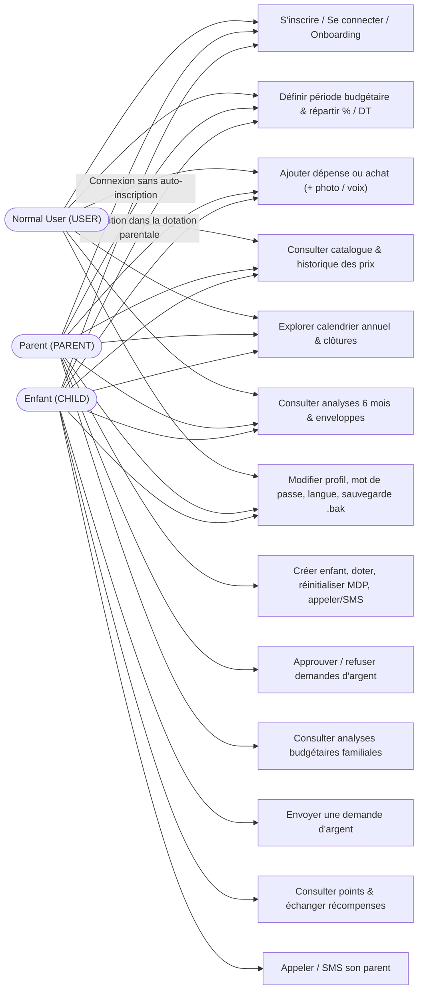
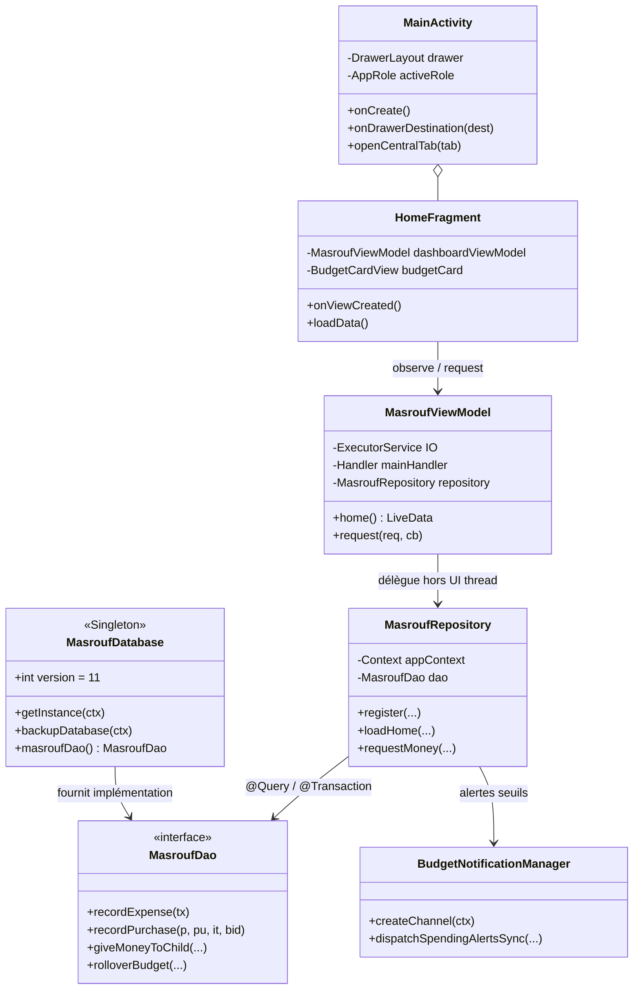
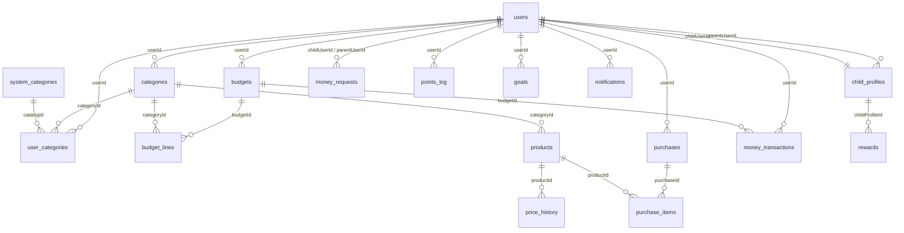

# Documentation Académique Unifiée — Masrouf Android Natif

> **Application** : Masrouf (`com.example.masrouf1`) — Gestionnaire de budget personnel et familial 100 % hors ligne  
> **Plateforme** : Android Natif — Java 11, XML Material Design 3, Room SQLite **version 11** (`18` tables)  
> **Référence** : Code source audité dans `app/src/main` et suites de tests `app/src/test` / `app/src/androidTest`

---

## 1. Présentation du sujet et objectifs pédagogiques

**Masrouf** répond au besoin de suivi rigoureux des finances quotidiennes d'un foyer en Tunisie sans dépendre d'une connexion Internet ni d'un serveur cloud.

### Objectifs fonctionnels et techniques
1. **Suivi financier au millime près** (`1 DT = 1 000 millimes`, sans flottants) des dépenses directes, achats produits, budgets mensuels/personnalisés et enveloppes par catégorie (`plannedPercentBps`).
2. **Suivi du catalogue produits et de l'inflation** : mémorisation des prix unitaires par magasin (`price_history`), courbe chronologique et alerte dès qu'un prix augmente de plus de 10 %.
3. **Gestion familiale Parent / Enfant avec confidentialité** : création des comptes enfants, dotation mensuelle depuis l'enveloppe parentale `Enfants`, approbation des demandes d'argent et suivi agrégé préservant la confidentialité du détail des dépenses de l'enfant.
4. **Accessibilité multilingue et vocale** : interface dynamique Français / Arabe (RTL) / Anglais et saisie vocale hors ligne FR / AR / EN / Darija (`VoiceParser`) avec aperçu toujours validé par l'utilisateur.
5. **Architecture Android propre et testable** : séparation UI XML/Java, `MasroufViewModel` (`LiveData`), `MasroufRepository`, `MasroufDao`, Room SQLite, WorkManager, Foreground Service, BroadcastReceiver, Notifications et FileProvider.

---

## 2. Identification des acteurs réels (et mise au point sur l'Admin)

D'après [AppRole.java](../../app/src/main/java/com/example/masrouf1/AppRole.java), l'application comporte exactement **3 acteurs** :

1. **Utilisateur Normal (`USER`, `"user"`)** : utilisateur individuel autonome qui crée son compte, configure ses catégories, définit ses budgets, saisit achats/dépenses et analyse ses courbes sur 6 mois.
2. **Parent (`PARENT`, `"parent"`)** : responsable familial qui possède les mêmes fonctions budgétaires qu'un `USER`, plus la gestion de ses enfants (`ChildrenManagementActivity`), les dotations familiales, la validation des demandes d'argent et les analyses familiales (`FamilyBudgetsAnalyticsActivity`).
3. **Enfant (`CHILD`, `"child"`)** : membre créé par un `PARENT`, limité aux catégories autorisées par son parent (`other` incluse), disposant d'une dotation fixe qu'il peut répartir, d'un écran de demande d'argent (`MoneyRequestActivity`) et d'un système de points/récompenses (`RewardsActivity`).

> **Signalement académique honnête** : **Il n'existe aucun rôle `Admin` distinct dans l'application.** Le parent administre uniquement son propre foyer familial (`parentUserId`). Dans [AppRole.java](../../app/src/main/java/com/example/masrouf1/AppRole.java), `AppRole.from("admin")` redirige vers `PARENT`. Les noms historiques `AdminDrawer` et `admin.masrouf@gmail.com` appartiennent en réalité au rôle `PARENT`.

---

## 3. Diagramme de Cas d'Utilisation

---

## 4. Spécification des principaux cas d'utilisation

| Cas d'utilisation | Acteur(s) | Préconditions | Scénario nominal | Composants clés |
|---|---|---|---|---|
| **Inscription & Onboarding** | `USER`, `PARENT` | Gmail unique + mot de passe 5 règles | Choix type compte -> `RegisterActivity` (PBKDF2) -> `LoginActivity` -> `OnboardingActivity` (3 étapes -> `finishOnboarding`) -> `MainActivity` | `WelcomeActivity`, `ChooseAccountTypeActivity`, `RegisterActivity`, `LoginActivity`, `OnboardingActivity`, `PasswordHasher` |
| **Définir & Répartir un Budget** | `USER`, `PARENT`, `CHILD` (répartition seule) | Utilisateur connecté | Sélection dates ISO & plafond -> validation non-chevauchement -> répartition bidirectionnelle `% ↔ DT` -> sauvegarde atomique | `BudgetPeriodActivity`, `AllocateBudgetActivity`, `BudgetPeriodMath`, `MasroufDao.insertBudgetWithEnvelopes` |
| **Enregistrer un Achat Produit** | Tous | Budget & catégorie `product` sélectionnés | Saisie nom/marque/prix/qté/unité/photo -> calcul prix unitaire -> `recordPurchase` (maj `products`, `purchases`, `purchase_items`, `price_history`, `budget_lines`, `budgets`, `money_transactions`) + alertes | `AddProductActivity`, `FormPriceTextWatcher`, `PhotoSourceBottomSheetDialog`, `BudgetNotificationManager` |
| **Saisie Vocale Multilingue** | Tous (`Dotation` si `PARENT`) | Permission `RECORD_AUDIO` | Clic FAB micro -> écoute `SpeechRecognizer` -> parsing FR/AR/EN/Darija (`VoiceParser`) -> aperçu éditable -> confirmation manuelle vers Room | `VoiceTransactionDialogFragment`, `VoiceSpeechController`, `VoiceParser`, `MasroufRepository` |
| **Doter un Enfant & Approuver une Demande** | `PARENT`, `CHILD` | `PARENT` connecté + budget actif | Parent crée/dote un enfant ou approuve `money_requests` -> débit enveloppe `Enfants` + crédit solde/dotation enfant + notification | `ChildrenManagementActivity`, `MoneyRequestActivity`, `MasroufDao.giveMoneyToChild` / `resolveMoneyRequest` |
| **Clôture & Reconduction Mensuelle** | Système (`AlarmManager` / `WorkManager`) | Budget `ACTIVE` avec `periodEnd <= now` | `BudgetEvaluationService` ou `BudgetRolloverWorker` exécute `rolloverBudget` (calcul moyenne 3/4, +100 pts si respecté, notification `budget_closed`) | `MasroufApplication`, `BudgetEvaluationService`, `BudgetRolloverWorker`, `BudgetNotificationManager` |

---

## 5. Architecture logicielle & Diagramme de Classes simplifié

L'application suit un modèle **hybride MVC (contrôleurs) + MVVM (`MasroufViewModel` / `LiveData`) + Repository (`MasroufRepository`) + DAO (`MasroufDao`) + Singleton Room (`MasroufDatabase`)**.

---

## 6. Diagramme Entité-Relation SQLite (18 Tables — Room v11)

*(Note : la 18e table `settings` est un singleton hors relations étrangères verrouillé sur `id = 1` par triggers SQLite.)*

---

## 7. Synthèse des exigences académiques et qualité

- **Tests unitaires** (`app/src/test/`) : 5 classes (`BudgetPeriodMathTest`, `VoiceParserTest`, `MoneyUtilsTest`, `InputValidationTest`, `ExampleUnitTest`).
- **Tests instrumentés** (`app/src/androidTest/`) : 3 classes (`RoomSelectionInstrumentedTest`, `PasswordVisibilityInstrumentedTest`, `ExampleInstrumentedTest`) nécessitant un appareil ou émulateur connecté.
- **Limites identifiées avec transparence** : pas de rôle super-administrateur distinct (`Admin` absent), détails transactions en lecture seule (`EditExpense`/`EditPurchase`), pas de formulaire UI de création dans `goals` / `rewards`, `BudgetAllocationReceiver` déclaré sans émission `sendBroadcast`.
