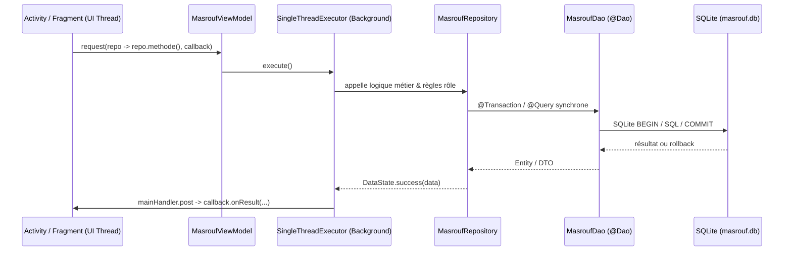

# Base de Données SQLite & Persistance — Masrouf Android Natif

---

## 1. Technologie, fichier physique et accès Singleton

| Élément | Valeur exacte vérifiée | Source |
|---|---|---|
| **Moteur / Bibliothèque** | **AndroidX Room `2.6.1`** au-dessus de SQLite natif Android | [libs.versions.toml](../gradle/libs.versions.toml), [app/build.gradle.kts](../app/build.gradle.kts) |
| **Nom de la base** | `"masrouf.db"` (avec fichiers compagnons `-wal` et `-shm` en journalisation WAL) | [MasroufDatabase.java#L188](../app/src/main/java/com/example/masrouf1/db/MasroufDatabase.java#L188) |
| **Emplacement sur le téléphone** | `/data/data/com.example.masrouf1/databases/masrouf.db` (stockage privé de l'application) | Standard Android `context.getDatabasePath("masrouf.db")` |
| **Sauvegarde locale vérifiée** | `no_backup/database-backups/masrouf.db.bak` via `VACUUM INTO` (ou repli `PRAGMA wal_checkpoint(FULL)` + copie transactionnelle) puis `PRAGMA integrity_check` | [MasroufDatabase.java#L198-L259](../app/src/main/java/com/example/masrouf1/db/MasroufDatabase.java#L198-L259) |
| **Version actuelle** | **`version = 11`**, `exportSchema = false` | [MasroufDatabase.java#L67](../app/src/main/java/com/example/masrouf1/db/MasroufDatabase.java#L67) |
| **Callback d'ouverture** | `REFERENCE_DATA_CALLBACK.onOpen()` : insère les **16 catégories système** (`SystemCategoryCatalog.defaults()`), le singleton `settings (id=1)` + triggers d'unicité `settings_singleton_insert` / `settings_singleton_update` | [MasroufDatabase.java#L155-L179](../app/src/main/java/com/example/masrouf1/db/MasroufDatabase.java#L155-L179) |

---

## 2. Les 18 tables SQLite (`MasroufEntities.java`)

Tous les montants financiers sont stockés en **`long` (millimes entiers : `1 DT = 1 000 millimes`)** pour garantir une exactitude comptable absolue.

| # | Table Room | Clé primaire | Clés étrangères (`ForeignKey`) & comportements | Colonnes principales |
|---|---|---|---|---|
| 1 | `users` | `id` (auto) | Aucune (index unique `email`, index `householdId`) | `householdId`, `name`, `email`, `role` (`user`/`parent`/`child`), `accountType`, `parentPhone`, `passwordHash`, `onboarded`, `categoriesSelected`, `balanceMilli`, `points`, `createdAt` |
| 2 | `child_profiles` | `id` (auto) | `parentUserId -> users.id` (CASCADE), `childUserId -> users.id` (CASCADE, unique) | `nickname`, `allocatedTotalMilli`, `allocationPeriodStart`, `parentPhone`, `weeklyLimitMilli`, `createdAt` |
| 3 | `categories` | `id` (auto) | `userId -> users.id` (CASCADE) | `name`, `colorHex`, `isEssential`, `type` (`product`/`expense`), `allocationPercent` |
| 4 | `system_categories` | `id` (fixe) | Aucune (index unique `key`) | `key`, `name`, `type`, `colorHex`, `iconName`, `recommendedPercent`, `protectedCategory` |
| 5 | `user_categories` | `id` (auto) | `userId -> users.id` (CASCADE), `categoryId -> categories.id` (CASCADE), `catalogId -> system_categories.id` (SET_NULL) | `active` (index unique `(userId, categoryId)`) |
| 6 | `products` | `id` (auto) | `categoryId -> categories.id` (CASCADE) | `name`, `brand`, `unit`, `photoPath`, `barcode`, `currentPriceMilli`, `currency`, `updatedAt` |
| 7 | `budgets` | `id` (auto) | `userId -> users.id` (CASCADE) | `name`, `monthlyLimitMilli`, `spentMilli`, `lastMonthSummaryMilli`, `periodStart`, `periodEnd`, `status` (`ACTIVE`/`CLOSED`), `pointsAwarded` |
| 8 | `budget_lines` | `id` (auto) | `budgetId -> budgets.id` (CASCADE), `categoryId -> categories.id` (CASCADE) | `limitMilli`, `spentMilli`, `plannedPercentBps` (`1 % = 100 bps`) |
| 9 | `purchases` | `id` (auto) | `userId -> users.id` (CASCADE) | `occurredAt`, `totalMilli`, `storeName`, `receiptPath` |
| 10 | `purchase_items` | `id` (auto) | `purchaseId -> purchases.id` (CASCADE), `productId -> products.id` (CASCADE) | `description`, `quantityMilli`, `unit`, `unitPriceMilli` |
| 11 | `money_transactions` | `id` (auto) | `userId -> users.id` (CASCADE), `budgetId -> budgets.id` (CASCADE) | `categoryId`, `kind` (`expense`/`purchase`/`donation`/`family_allocation`/`allowance_received`), `label`, `note`, `amountMilli`, `occurredAt` |
| 12 | `price_history` | `id` (auto) | `productId -> products.id` (CASCADE) | `priceMilli`, `observedAt`, `storeName` |
| 13 | `money_requests` | `id` (auto) | `childUserId -> users.id` (CASCADE), `parentUserId -> users.id` (CASCADE) | `amountMilli`, `reason`, `status` (`pending`/`accepted`/`rejected`), `createdAt`, `updatedAt`, `responseNote` |
| 14 | `points_log` | `id` (auto) | `userId -> users.id` (CASCADE) | `eventKey` (unique par `userId`), `points`, `reason`, `createdAt` |
| 15 | `rewards` | `id` (auto) | `childProfileId -> child_profiles.id` (CASCADE) | `title`, `pointsCost`, `redeemed`, `createdAt` |
| 16 | `goals` | `id` (auto) | `userId -> users.id` (CASCADE) | `title`, `targetMilli`, `savedMilli`, `dueAt` *(aucun écran de création exposé actuellement)* |
| 17 | `notifications` | `id` (auto) | `userId -> users.id` (CASCADE) | `title`, `message`, `kind`, `createdAt`, `read`, `eventKey` (unique par `userId`) |
| 18 | `settings` | `id` (auto=1) | Singleton verrouillé par triggers SQLite `settings_singleton_insert/update` | `pointsPerPeriod`, `pointsPerCategory`, `pointsMonthlyBonus`, `pointsStreakBonus`, `streakLength`, `thresholdBeginner`, `thresholdSaver`, `thresholdExpert`, `greenUntil` (`79`), `orangeFrom` (`80`), `redFrom` (`100`) |

---

## 3. Historique des 10 migrations (`1 -> 11`)

Déclarées dans [MasroufDatabase.java#L70-L153](../app/src/main/java/com/example/masrouf1/db/MasroufDatabase.java#L70-L153) sans aucune destruction de données (`fallbackToDestructiveMigration` absent) :
- **1 → 2** : ajout de `users.passwordHash`, `users.onboarded`, `users.balanceMilli`.
- **2 → 3** : ajout de `categories.type`, `categories.allocationPercent`.
- **3 → 4** : ajout de `users.accountType`, `users.parentPhone`, `child_profiles.allocatedTotalMilli`, `child_profiles.parentPhone`.
- **4 → 5** : ajout de `money_transactions.categoryId` + index.
- **5 → 6** : ajout de `products.brand`, `products.unit`, `products.photoPath`, `purchase_items.unit`.
- **6 → 7** : ajout de `money_transactions.note`.
- **7 → 8** : ajout de `users.categoriesSelected`, création des tables `system_categories`, `user_categories` et `settings` + triggers singleton.
- **8 → 9** : ajout de `notifications.eventKey` (unique par utilisateur), création de `money_requests` et `points_log`.
- **9 → 10** : ajout de `child_profiles.allocationPeriodStart` + recalcul depuis le budget actif.
- **10 → 11** : ajout de `budget_lines.plannedPercentBps` + recalcul `(limitMilli * 10000) / monthlyLimitMilli` + mise à jour des `recommendedPercent` du catalogue.

---

## 4. Fonctionnement synchrone de SQLite vs asynchronisme applicatif

**Important** : SQLite est **synchrone par nature** — chaque requête SQL bloque le thread qui l'exécute. `Masrouf1` empêche tout blocage du thread interface (**ANR**) par quatre mécanismes complémentaires dans le code :

1. **`Executors.newSingleThreadExecutor()` + `Handler(Looper.getMainLooper())`** dans [MasroufViewModel.java#L55,L83,L135-L143](../app/src/main/java/com/example/masrouf1/MasroufViewModel.java#L55) : la méthode `viewModel.request(...)` exécute `MasroufRepository` sur un thread d'arrière-plan unique (`IO`), encapsule dans `DataState` puis poste le callback sur le `MainLooper` si le `ViewModel` n'est pas détruit (`!cleared`).
2. **`Executors.newSingleThreadExecutor()` dédiés aux contrôleurs système** : `MainActivity.ACCOUNT_GATE`, `SettingsFragment.BACKUP_EXECUTOR`, `BudgetNotificationManager.IO`, `BudgetEvaluationService.IO`, `ChangePasswordActivity.EXECUTOR`.
3. **Room `LiveData` & `MediatorLiveData`** (`observeProducts`, `observeCategories`, `observePriceHistory`, `observeTransactions`, `observeNotifications`, `observeUser`) : Room exécute automatiquement la requête sur son exécuteur interne `ArchTaskExecutor` et pousse les mises à jour vers le thread principal dès qu'une table observée est modifiée.
4. **Transactions SQLite atomiques (`@Transaction`)** dans [MasroufDao.java](../app/src/main/java/com/example/masrouf1/db/MasroufDao.java) : `recordExpense`, `recordPurchase`, `createChildAccount`, `giveMoneyToChild`, `resolveMoneyRequest`, `insertBudgetWithEnvelopes`, `updateBudgetWithEnvelopes`, `finishOnboarding`, `updateUserCategorySelections`, `rolloverBudget`, `redeemReward`, `awardPointsOnce`, `deleteExpenseTransaction`. En cas d'erreur, toute l'opération est annulée (`rollback`) d'un bloc.

---

## 5. Persistance, durée de vie et risques de perte de données

- **Persistance durable** : les données survivent aux fermetures d'écran, rotations, mises à jour de schéma (migrations `1 -> 11`) et redémarrages du téléphone grâce au stockage flash interne dans `masrouf.db`.
- **Conditions réelles de perte de données** :
  1. Désinstallation de l'application (`Android` supprime `/data/data/com.example.masrouf1/`, y compris `databases/masrouf.db` et `no_backup/database-backups/masrouf.db.bak`).
  2. Action manuelle système **« Effacer les données / le stockage »** dans les paramètres Android.
  3. **Absence de synchronisation cloud** : aucune sauvegarde distante (Firebase/API REST) n'existe ; en cas de perte/casse du téléphone sans récupération manuelle du `.bak`, les données sont perdues.
  4. **Photos produits** : seul le chemin `photoPath` est stocké en base ; si l'image dans le cache ou stockage externe est effacée hors contrôle de l'app, la fiche produit reste en base sans photo affichable.
  5. **Édition/Suppression UI** : aucune transaction ne peut être perdue par erreur d'édition car `EditExpenseActivity`/`EditPurchaseActivity`/`TransactionDetailsActivity` sont en lecture seule (`deleteExpenseTransaction` existe en DAO mais n'est pas branchée à l'UI).
