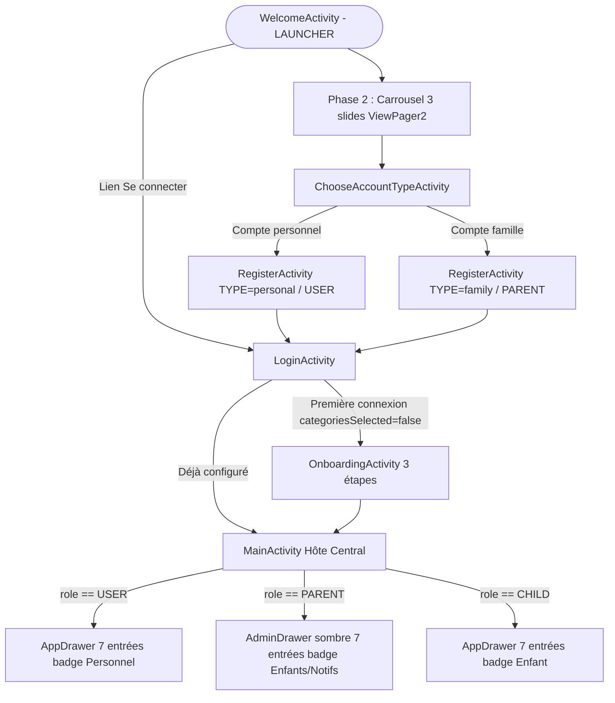
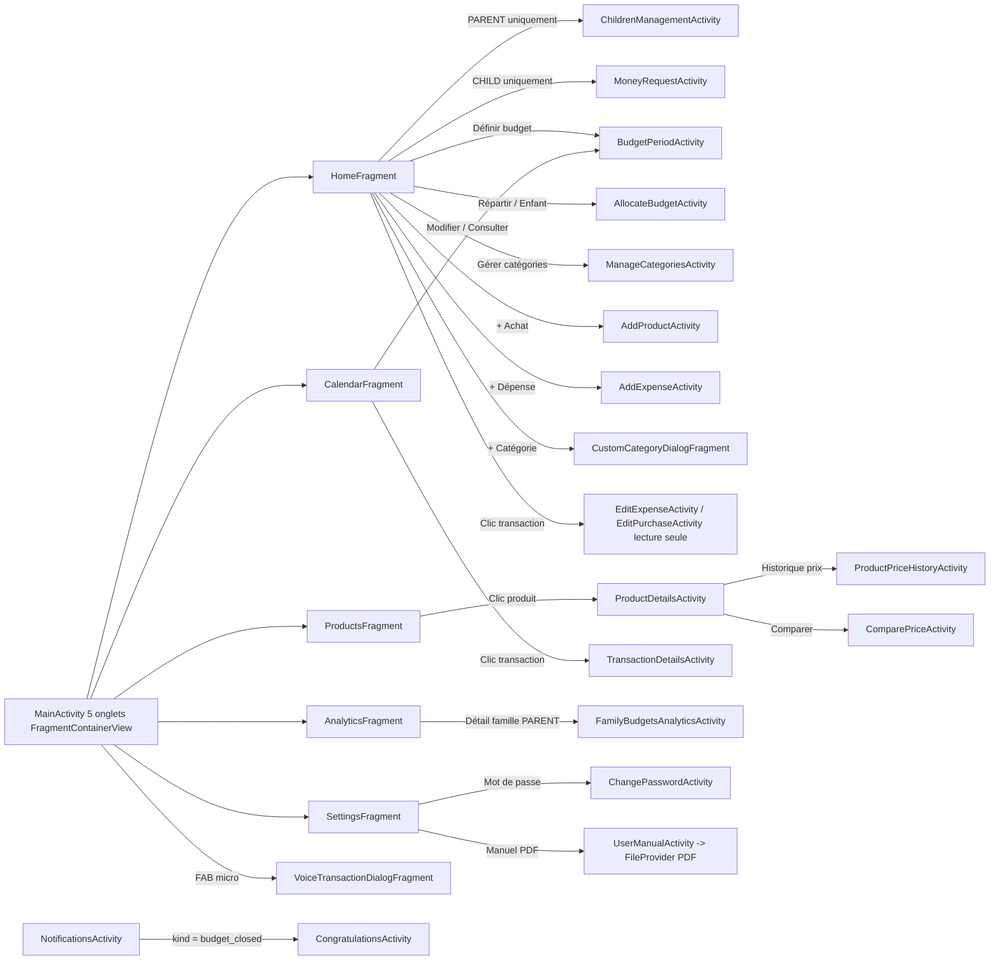

# Architecture & Navigation Android — Masrouf Android Natif

---

## 1. Architecture logicielle réelle

`Masrouf1` combine :
- Des **écrans Activity et Fragment** organisés entre `com.example.masrouf1` (coque principale, services, workers, base Room, vues) et `com.masrouf.controller` (écrans auth, onboarding, formulaires, gestion famille).
- Un **ViewModel partagé par écran** (`MasroufViewModel` + `MasroufViewModelFactory`) portant l'état asynchrone (`DataState<T>`).
- Un **Repository central** (`MasroufRepository`, 1 417 lignes) encapsulant **Room `MasroufDao`** et les notifications `BudgetNotificationManager`.
- **Aucune bibliothèque `Jetpack Navigation`** : toute la navigation intra-application utilise le `FragmentManager` (`add`/`hide`/`show` pour les 5 onglets centraux) et des `Intent` explicites Android.

---

## 2. Diagrammes Mermaid des parcours réels

### 2.1 Parcours d'authentification et routage par profil (`MainActivity.ACCOUNT_GATE`)

### 2.2 Navigation centrale (`MainActivity`) et écrans secondaires

---

## 3. Explicit Intents & Extras transmis

| Écran source | Écran cible | Clés `Intent` transmises (`putExtra`) & flags | Condition d'accès |
|---|---|---|---|
| `WelcomeActivity` | `ChooseAccountTypeActivity` | Aucune | Fin carrousel 3 slides |
| `WelcomeActivity` / `ChooseAccountTypeActivity` | `LoginActivity` | `EMAIL` (depuis `RegisterActivity`) | Compte existant |
| `ChooseAccountTypeActivity` | `RegisterActivity` | `"TYPE"` (`"personal"` ou `"family"`) | Création compte `USER` ou `PARENT` |
| `LoginActivity` | `OnboardingActivity` | `"USER_ID"` | Si `categoriesSelected == false` |
| `LoginActivity` / `OnboardingActivity` / `BaseFeatureActivity` / `ChildrenManagementActivity` | `MainActivity` | `EXTRA_CENTRAL_TAB` (`"home"`, `"products"`, `"calendar"`, `"analytics"`, `"settings"`), `EXTRA_SUCCESS_MESSAGE` + flags `CLEAR_TOP` / `NEW_TASK` | Session active valide (`SessionStore.userId > 0`) |
| `MainActivity` (Drawer) / `HomeFragment` | `ChildrenManagementActivity` | `USER_ID` (depuis `MainActivity.onDrawerDestination`), lit `SessionStore.userId` | Rôle `PARENT` |
| `MainActivity` (Drawer) / `SectionActivity` | `RewardsActivity` | `USER_ID` (depuis `MainActivity.onDrawerDestination`) | `disallowParentRole()` — bloqué pour `PARENT` |
| `HomeFragment` (mode `CHILD`) | `MoneyRequestActivity` | Aucun extra | Rôle `CHILD` (vérifié en Repository) |
| `CalendarFragment` / `HomeFragment` | `BudgetPeriodActivity` | `"MODE"`, `"BUDGET_ID"`, `"READ_ONLY"`, `"DEFAULT_START"`, `"DEFAULT_END"` | `USER` / `PARENT` (historique passé en `READ_ONLY`) |
| `BudgetPeriodActivity` / `HomeFragment` | `AllocateBudgetActivity` | `"BUDGET_ID"`, `"START"`, `"END"`, `"TOTAL"`, `"IS_CHILD"`, `"READ_ONLY"` | Tous profils (plafond verrouillé si `IS_CHILD`) |
| `ProductsFragment` | `ProductDetailsActivity` | `"PRODUCT_ID"` | Tous profils |
| `ProductDetailsActivity` | `ProductPriceHistoryActivity` / `ComparePriceActivity` | `"PRODUCT_ID"`, `"PRODUCT_NAME"` | Tous profils |
| `HomeFragment` / `CalendarFragment` / `AnalyticsFragment` | `EditExpenseActivity`, `EditPurchaseActivity`, `TransactionDetailsActivity` | `"TRANSACTION_ID"` (`EditExpense` / `EditPurchase` héritent de `TransactionDetailActivity`) | Propriétaire de la transaction |
| `NotificationsActivity` | `CongratulationsActivity` / `RewardsActivity` / `MoneyRequestActivity` / `ChildrenManagementActivity` | Selon `NotificationEntity.kind` (`budget_closed`, `points_awarded`, `money_request`...) | Utilisateur connecté |
| `SettingsFragment` | `UserManualActivity` -> lecteur externe | Copie PDF vers `cache/manual/manuel_utilisation.pdf` + `FileProvider` | Tous profils |

> **Activités de redirection rétrocompatibles** : `ProductsActivity`, `CalendarActivity`, `AnalyticsActivity` et `SettingsActivity` redirigent immédiatement vers `MainActivity` avec `EXTRA_CENTRAL_TAB`.

---

## 4. Implicit Intents (`SystemIntents.java`, `PhotoSourceBottomSheetDialog`, `VoiceSpeechController`)

| Action Android (`Intent`) | Cible / MIME / URI | Fichier & méthode | Rôle et résultat à l'écran |
|---|---|---|---|
| `Intent.ACTION_DIAL` | `tel:<numero>` | [SystemIntents.java#L45-L49](../app/src/main/java/com/example/masrouf1/SystemIntents.java#L45-L49) (`dialHousehold` / `dial`) | Ouvre le composeur téléphonique sans nécessiter la permission `CALL_PHONE` (depuis `SettingsFragment` Enfant ou `ChildrenManagementActivity`). |
| `Intent.ACTION_SENDTO` | `smsto:<numero>` + extra `"sms_body"` | [SystemIntents.java#L53-L57,L85-L91](../app/src/main/java/com/example/masrouf1/SystemIntents.java#L53-L57) (`shareReceipt` / `sendSms`) | Ouvre l'application SMS par défaut avec destinataire et message prérempli. |
| `Intent.ACTION_SEND` | `text/plain` + `EXTRA_SUBJECT`, `EXTRA_TEXT` via `createChooser` | [SystemIntents.java#L105-L111](../app/src/main/java/com/example/masrouf1/SystemIntents.java#L105-L111) (`shareText`) | Feuille de partage système pour diffuser le résumé budgétaire depuis `SettingsFragment`. |
| `Intent.ACTION_VIEW` + `FileProvider` | `content://<package>.fileprovider/...` type `application/pdf` + `FLAG_GRANT_READ_URI_PERMISSION` | [SystemIntents.java#L65-L78](../app/src/main/java/com/example/masrouf1/SystemIntents.java#L65-L78) (`openManual`) | Ouvre le manuel `res/raw/manuel_utilisation.pdf` dans la visionneuse PDF installée. |
| `MediaStore.ACTION_IMAGE_CAPTURE` | Repli via `ActivityResultContracts.TakePicture` | [SystemIntents.java#L59-L63](../app/src/main/java/com/example/masrouf1/SystemIntents.java#L59-L63) et [PhotoSourceBottomSheetDialog.java](../app/src/main/java/com/masrouf/controller/PhotoSourceBottomSheetDialog.java) | Capture une photo produit (caméra ou galerie `GetContent("image/*")`). |
| `RecognizerIntent.ACTION_RECOGNIZE_SPEECH` | Langue dynamique (`fr-FR`, `ar-TN`, `en-US`) | [VoiceSpeechController.java](../app/src/main/java/com/masrouf/controller/VoiceSpeechController.java) | Repli système si `SpeechRecognizer` natif renvoie une indisponibilité. |

**Note honnête sur les Intents absents** : aucun `ACTION_CALL` direct (appel téléphonique silencieux sans validation utilisateur) ni ouverture d'URL Web externe (`http://`/`https://`) n'est présent dans l'application.
